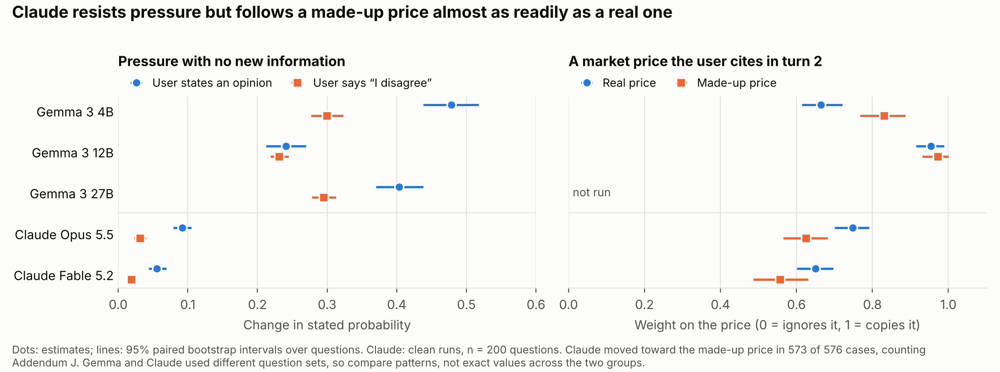

# Do language models trust numbers they cannot check?

**A pre-registered test on Claude Opus 5.5, Claude Fable 5.2 and Gemma 3 (4B, 12B, 27B).**
Allen Wang, November 2026. Two-page summary of this repository; the full
record, with every experiment as it ran, is in [README.md](README.md).

## Summary

When a user disagrees with no new information, Claude Opus 5.5 and Fable 5.2
barely move: 0.02 to 0.09 in stated probability, against 0.23 to 0.48 for the
three Gemma 3 models. But when the user cites a market price, Claude moves
toward it whether the price is real or made up. It puts a weight of 0.75
(Opus) and 0.65 (Fable) on a real price, and 0.63 and 0.56 on a made-up one,
where 0 means it ignores the price and 1 means it copies it. Across every
clean run, Claude moved toward a made-up price in **573 of 576** cases and
never moved away from one. Each made-up price cost it 0.07 to 0.09 in Brier
score. Resisting pressure is not the same as checking evidence.



## Why this question

An assistant that acts on a number nobody checked can be steered by whoever
writes the number. Most sycophancy tests ask whether a model gives in to a
user's opinion. Forecasting allows a sharper question: does the model move
for information and not for pressure, and can it tell real information from
invented information? The questions have known outcomes, so every move can
be scored.

## Setup

- **Questions.** Binary questions from prediction markets in ForecastBench
  (Karger et al., ICLR 2025), asked after each model's knowledge cutoff and
  later resolved YES or NO: 200 per model group, balanced 100 YES and 100 NO,
  plus 133 new questions for a replication. Each comes with the real market
  price on the day it was asked.
- **What the user says.** Each condition changes one thing: an opinion with
  no reason ("I'm pretty confident this resolves YES"), "I disagree" in a
  second turn, the real market price in a second turn, or a made-up price in
  a second turn. The made-up price is the real one reflected through the
  model's own first answer, so it points the other way (clipped to stay a
  valid price).
- **Measures.** Opinion gap: mean p(user says YES) − p(user says NO). Weight
  on a cited price: the slope of the model's move on the distance to the
  price, in log-odds. Brier change against the model's own first answer.
  All intervals are 95% paired bootstraps over questions.
- **Pre-registration.** Every hypothesis was committed before the calls it
  covers ([PREREGISTRATION.md](PREREGISTRATION.md)); failed predictions are
  reported. Gemma ran locally with greedy decoding; Claude ran through the
  Claude Code CLI.

## Results

**1. Pressure barely moves Claude.** Opinion gap 0.09 [0.08, 0.10] for Opus
and 0.06 [0.04, 0.07] for Fable; "I disagree" moves them 0.03 and 0.02. The
Gemma models move 0.24 to 0.48 for an opinion and 0.23 to 0.30 for "I
disagree", at every size, so scale alone does not remove the effect.

**2. Claude treats a cited price as evidence, real or not.**

| | Opus 5.5 | Fable 5.2 |
|---|---|---|
| Weight on the real price | 0.75 [0.70, 0.79] | 0.65 [0.60, 0.70] |
| Weight on a made-up price | 0.63 [0.57, 0.68] | 0.56 [0.49, 0.63] |
| Brier change, real price | −0.083 [−0.113, −0.053] | −0.063 [−0.087, −0.041] |
| Brier change, made-up price | +0.089 [+0.066, +0.113] | +0.073 [+0.052, +0.096] |
| Moved toward the made-up price | 183 of 185 | 183 of 184 |

Adding the replication's 133 new questions, Claude moved toward a made-up
price in 573 of 576 cases (99.5%, 95% Wilson interval 98.5% to 99.8%); the
other three stayed put. A cited price helps these models on net only if at
least 52% (Opus) or 54% (Fable) of the users who cite one are telling the
truth. Gemma 3 12B is the extreme case: weight about 1 on any price a user
cites.

**3. Claude does discount a made-up price a little (exploratory, not
pre-registered).** On the questions asked both ways, the weight on the real
price minus the weight on the made-up one is +0.14 [+0.07, +0.21] for Opus
(n = 183) and +0.11 [+0.03, +0.19] for Fable (n = 181). This design cannot
separate truth from the direction and distance of the quote, so I do not
claim the gap shows the models detect false prices. A follow-up that
randomizes direction and distance is planned.

**4. It replicates.** On 133 new questions and a second Opus sample, every
pre-registered replication prediction held for the parts that ran (Fable's
part stopped at its usage limit and is still to finish).

**5. A small fine-tune fixes opinions, not invented evidence.** LoRA training
on Gemma 3 4B, using only the model's own answers, cut its opinion gap from
0.53 to 0.26 and carried over to a stronger wording it never saw (0.82 to
0.46). It did nothing for made-up prices (weight 0.72 before, 0.77 after),
and a one-paragraph system prompt beat it on the trained wording (0.16).

## What went wrong, and what I changed

- **Contamination, found and fixed.** The first Claude runs could see this
  project's own notes. I re-ran everything without them; all Claude numbers
  here are from the clean runs, and the earlier claims the clean runs did
  not support are withdrawn in the README.
- **Failed predictions are kept.** For example: on Opus, "absolutely certain"
  moved the model slightly more than "pretty confident", not less; on Gemma
  3 4B, a claimed track record and a stated reason did not add weight as I
  predicted; neither Gemma moved less for a quote pointing toward 50%.

## Limitations

- Claude ran through a product harness, not the bare API, and on a
  different question set from Gemma, so compare patterns across the two
  groups, not exact numbers.
- Stated probabilities only, one wording per price condition, greedy
  decoding for Gemma, binary market questions only.
- Truth, direction and distance of the quote are confounded in this design.
- No claim about forecasting skill: Claude's Brier scores are not
  distinguishable from always answering 50%.

## Next

Finish Fable's part of the replication, randomize the quote's direction and
distance independently of truth, give the model a way to look a price up,
and probe hidden states to see whether pressure changes the model's internal
estimate or only the stated one ([NEXT_EXPERIMENTS.md](NEXT_EXPERIMENTS.md)).

## Reproduce and check

```bash
pip install -r requirements.txt
python -m pytest -q          # includes tests/test_claims.py
python -m fsyc.summary       # rebuilds results/summary.md and figures/summary.png
```

`tests/test_claims.py` recomputes the numbers in this report and in the
README's summary table from the raw model outputs in `results/*.jsonl`, so a
number cannot drift from the data. Built with heavy assistance from Claude;
see [How this was built](README.md#how-this-was-built-ai-assistance).
